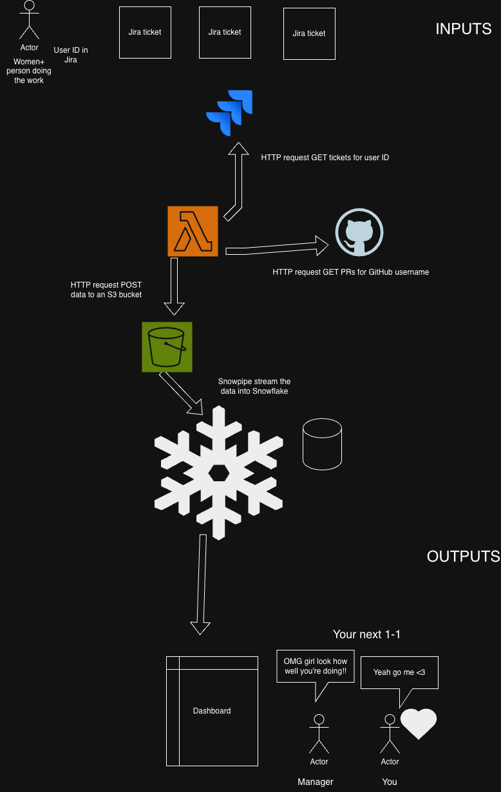

--- Written my me ---

# Women+ Visibility Hackathon

## Architecture


## Process
- I used AI to implement most of the code in this repo and most of this README
- I came up with the original idea before the day and my team expanded on it, winning us the third place prize
- I made the architecture diagramme myself
- I gave GitHub Copilot the following prompts to implement this basic proof of concept:
   - hi, I want to make a serverless lambda function in Typescript that gets story points from the Jira REST API for a given Jira user. Is this feasible using the Jira REST API? https://developer.atlassian.com/cloud/jira/platform/rest/v3/
   - great please can you make me an AWS lambda in TypeScript that:
      1. Uses an .env file with environment variables for the user account ID below, API key and any other credentials I need to invoke the Jira API
      2. Gets the user with account ID [my Jira account ID]
      3. Gets all the fields for the project "SASC"
      4. Search for issues where the current assignee is the user retrieved in step 2
      5. Writes the information to a JSON object with this structure:
         {
            name: [name retrieved from the user in step 2]
            points: [sum of the numeric point values]
         }
      6. Writes the JSON object to an AWS S3 bucket
   - please can you refactor it so each responsibility is in its own function inside the lambda? I want one function that retrieves your user, one that discovers SASC fields, one that paginates assigned issues, one that sums story points, and one that uploads the JSON to S3
   - do you think it's possible for me to do the same thing but counting PRs that a GitHub user has created using the GitHub API?
   - great please can you do that for me using the GitHub username "Evie-Skinner18" ? Organisation "edfenergy". Those two will be environment variables. Please search for all PRs ever created and write the results to the same S3 bucket we're already using

--- The following text was generated by GitHub Copilot ---

## Jira story points to S3

An AWS Lambda in TypeScript that retrieves a Jira Cloud user, discovers the fields available in SASC, sums story points on all issues currently assigned to that user, and writes a JSON summary to a private S3 object.
All authored code, including local scripts and tests, is TypeScript.
The compiler emits ignored JavaScript build output in `dist` because Lambda's Node.js runtime executes JavaScript.

```json
{ "name": "Johnny Lawrence", "points": 8 }
```

The configured account ID is `712020:b92d45a9-f26e-48c2-8d3c-3f1d7cb63fc7`.
The name comes from Jira's `displayName`.
There is no status, sprint, issue-type, or date filter.
Null or absent estimates do not contribute to the sum.
Numeric zero and fractional estimates are included.
Non-numeric estimates cause a failure instead of publishing an unreliable total.
Story points describe estimates on currently assigned issues, not individual productivity or historical completion credit.

## Lambda responsibilities

The handler in [index.ts](./index.ts) coordinates separate functions:

- `retrieveUser` fetches and validates the target Jira user.
- `discoverProjectFields` retrieves all project-field pages and resolves field names.
- `paginateAssignedIssues` streams assigned issues across every search page.
- `sumStoryPoints` consumes that stream and validates and totals the estimates.
- `uploadSummaryToS3` writes the JSON summary to S3.

Shared helpers handle configuration, authenticated Jira requests, and story-point field selection.
Issues are processed as they arrive, without retaining every issue payload in memory.
The upload only starts after the entire stream has been consumed successfully.

## Count GitHub pull requests

The GitHub handler runs separately from Jira.
It counts pull requests created by a GitHub user in an organisation, regardless of creation date or current status, and writes a separate object to the same S3 bucket.
For example:

```json
{ "name": "Evie-Skinner18", "pullRequests": 42 }
```

Add these variables to your local `.env`, alongside the existing `AWS_REGION` and `S3_BUCKET`:

```dotenv
GITHUB_USERNAME=your username
GITHUB_ORGANISATION=edfenergy
GITHUB_TOKEN=your-approved-token
GITHUB_S3_KEY=github/edfenergy/pr-count.json
```

Replace the placeholder token with an approved credential in your local file.
Use a different object key from `S3_KEY` so the Jira summary is not overwritten.
The AWS identity needs `s3:PutObject` permission on the GitHub object as well as the Jira object.
Run the GitHub handler locally with:

```sh
npm run start:github
```

For Lambda, the same ZIP can be used with the handler `dist/github.handler`.
Set the GitHub variables, `AWS_REGION` and `S3_BUCKET` on that function, and use an execution role with permission to write its object.
The GitHub handler does not require the Jira variables.
It returns the summary after S3 confirms the upload.

The GitHub token must have access to the relevant repositories and any organisation SSO authorisation required.
See the [GitHub search API](https://docs.github.com/en/rest/search/search#search-issues-and-pull-requests) for token permissions and search limits.
The count includes only repositories visible to the token, which may exclude private repositories.
Search can examine at most 4,000 repositories, so the count may not cover a larger organisation.
GitHub search indexing is not necessarily immediate.
The handler uses `total_count` rather than fetching PR pages and rejects results marked incomplete.
HTTP errors, including rate limits, fail the invocation without writing an object.
Each successful invocation replaces the configured GitHub S3 object.
PR counts are not a complete measure of individual contribution or productivity.

## Local setup

Use Node.js 22 and npm.
The development version is recorded in [.nvmrc](./.nvmrc).
Run commands from this repository's root.

1. Run `npm ci`.
2. Fill in the local `.env`, which is ignored by Git.
   If it is missing, copy [.env.example](./.env.example) to `.env`.
3. Configure an authorised AWS profile or SSO session locally.
   The AWS SDK uses its default credential provider chain.
4. Run `npm test` and `npm start`.

`npm start` loads `.env` with Node's native `--env-file` option.
Existing process environment variables take precedence.
It performs a real Jira read and S3 write, so only run it against an approved destination.
Successful runs print a confirmation without logging the user's name or credentials.

| Variable | Purpose |
| --- | --- |
| `JIRA_BASE_URL` | Jira site URL, for example `https://your-domain.atlassian.net` |
| `JIRA_EMAIL` | Email address of the integration account authenticating to Jira |
| `JIRA_API_TOKEN` | API token belonging to the integration account, not its password |
| `JIRA_ACCOUNT_ID` | Target user's account ID, which can differ from the integration account |
| `JIRA_PROJECT_KEY` | Project to query, initially `SASC` |
| `JIRA_STORY_POINTS_FIELD_ID` | Optional field ID if automatic discovery is ambiguous or the field has been renamed |
| `AWS_REGION` | Region of the destination bucket |
| `S3_BUCKET` | Existing private destination bucket name |
| `S3_KEY` | Destination object key, initially `jira/SASC/story-points.json` |
| `AWS_PROFILE` | Optional local AWS profile, not needed in Lambda |

Use an organisation-approved Jira integration account and authentication arrangement.
The code uses [email and API-token authentication](https://developer.atlassian.com/cloud/jira/platform/basic-auth-for-rest-apis/).
For a scoped Atlassian API token, set `JIRA_BASE_URL` to `https://api.atlassian.com/ex/jira/YOUR_CLOUD_ID` as required by Atlassian.
Do not put real API tokens or AWS access keys in source control or chat.
Do not package `.env` with the Lambda.

## Jira permissions and field discovery

The authenticating account needs access to the target user's profile, Browse Projects permission for SASC, and access to the relevant issues under Jira issue-security rules.
The result includes only issues visible to that account.
The function cannot detect issues hidden by permissions, so check the integration account's access before relying on totals.

The function uses these REST API v3 endpoints:

1. `GET /user?accountId=...` retrieves the target account and display name.
2. `GET /project/SASC?expand=issueTypes` retrieves the project ID and all its issue types.
3. `GET /projects/fields` retrieves every page of fields available for that project and its issue types.
4. `GET /field` supplies names for the project-specific field IDs.
5. `POST /search/jql` retrieves every page for `project = "SASC" AND assignee = "..."`.

Project field associations are deduplicated and matched against the field catalogue.
Field definitions are used in memory, not added to the output JSON.
Automatic discovery accepts `Story Points` or `Story point estimate`, case-insensitively.
If there is not exactly one match, set `JIRA_STORY_POINTS_FIELD_ID` to a field available in SASC.
This avoids accidentally counting a similarly named field from another project.
If the project-field endpoint is unavailable on your Jira site, the function fails rather than falling back to site-wide fields.

See Atlassian's [project API](https://developer.atlassian.com/cloud/jira/platform/rest/v3/api-group-projects/), [field API](https://developer.atlassian.com/cloud/jira/platform/rest/v3/api-group-issue-fields/), and [enhanced issue search](https://developer.atlassian.com/cloud/jira/platform/rest/v3/api-group-issue-search/#api-rest-api-3-search-jql-post).

## AWS Lambda setup

This repository prepares code but does not create resources or deploy anything.

1. Create or choose an approved private S3 bucket in `AWS_REGION`.
2. Give the Lambda execution role CloudWatch Logs permissions and `s3:PutObject` on the exact destination object.
   For example, scope the S3 resource to `arn:aws:s3:::YOUR_BUCKET/jira/SASC/story-points.json`.
   If the bucket requires a customer-managed KMS key, grant the corresponding KMS permissions and key-policy access.
3. Run `npm run package`.
   This requires the `zip` command and creates `lambda.zip` containing compiled code and runtime dependencies.
   The package excludes `.env`, tests, and development-only TypeScript packages.
4. Upload that archive to a Lambda configured for Node.js 22.x with handler `dist/index.handler`.
5. Configure the variables listed above in Lambda, except `AWS_PROFILE`.
   Use the execution role for AWS credentials.
   Inject Jira credentials from your approved secret-management process.
   The handler reads runtime environment variables and does not retrieve Secrets Manager secrets itself.
6. Configure a suitable timeout, initially 300 seconds, and ensure the Lambda has outbound HTTPS access to Jira and S3.
   A Lambda in private VPC subnets needs appropriate network routing.
7. Invoke with an empty event `{}`.
   The handler ignores event data, writes the object, and returns the same `{ name, points }` summary after S3 confirms the write.

Each successful invocation replaces the configured S3 object.
Choose a dedicated key and enable S3 versioning if previous results must be recoverable.
Keep the bucket private because the object contains a person's display name.
Failed reads never upload a partial summary.
S3 failures reject the invocation.
Requests to Jira time out after 30 seconds each.
Jira HTTP errors, including rate limiting, reject the invocation without logging the response body.
There is no internal Jira retry loop.
Configure invocation retries according to your trigger and Jira rate limits.
The total is a read-time view, not an atomic historical snapshot, and may reflect changes while pagination is running.

## Validation

```sh
npm run typecheck
npm test
npm run package
```

Tests mock Jira and S3, including the actual `PutObjectCommand` payload.
They cover pagination, field discovery, numeric aggregation, empty results, credentials validation, malformed responses, HTTP errors, and upload failures.
They do not require credentials and do not call live services.
An authorised end-to-end invocation is still needed to verify the real Jira configuration and bucket permissions.